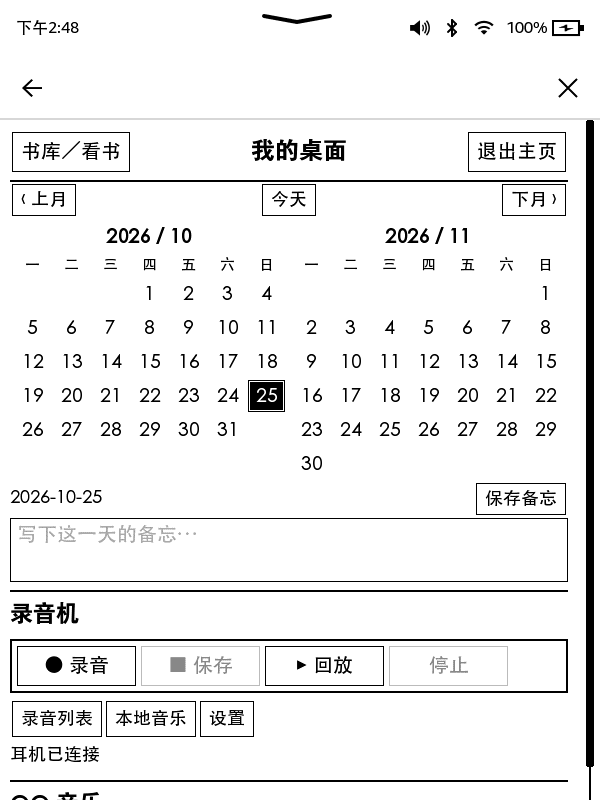

# Kindle 8 / KT3：离线主页与蓝牙双工改造

将 Kindle 8（KT3 / heisenberg）改造成保留原系统阅读能力的电子纸桌面：双月日历、日期备忘、蓝牙耳机录音与回放、本地音乐，以及预留的 DeepSeek 文本对话。

本仓库记录 **2026-10-24～25 的单机工程实践**，包含技术文档、脱敏排障日志、参考源码和测试。它不是通用第三方 ROM，也不是下载后直接刷入的固件包。设备原厂固件为 **5.16.2.1.1**；其他型号和固件未验证。

## 本次升级的亮点

1. **解除本机主页必须联网才能打开的限制。** 使用原厂 Mesquite 的本地应用入口加载 HTML，经回环接口调用服务。关闭 Wi-Fi、拔掉 USB 后，主页、耳机录放和原书库阅读已实测通过。
2. **从书库点击 KUAL 直接进入主页。** 不再经过中间菜单；保留返回 KUAL 菜单的标记开关。热入口脚本就绪时间从一次基线约 9.83 秒降至两次约 4.21 / 4.14 秒。
3. **AirPods 持续双工。** 录音、保存、回放共用 HFP/SCO 会话；已配对耳机入盒后保留控制服务，取出后直接向同一耳机重连，不重新扫描附近设备。
4. **与原系统看书共存。** 返回书库可保留音频会话；明确退出主页才有序结束服务、恢复原生音频。修复原生蓝牙查询被阻塞导致的界面错误。
5. **有边界的恢复机制。** 独立看门狗、会话锁、进程身份检查、恢复超时和分层回滚；保持手动启动，不启用开机自启。
6. **轻量桌面。** 左右双月日历、按日期保存备忘、长条录音机、录音列表、本地 MP3/WAV、QQ 音乐入口和待密钥的 DeepSeek 文本模块。



截图为实际设备上半页；向下滚动可见音乐和文本模块。截图中的空备忘不含私人内容。

## 功能状态

| 功能 | 结果与边界 |
|---|---|
| 关闭 Wi-Fi、拔 USB 后打开主页 | 已通过设备日志与用户实测交叉验证 |
| 本机录音、保存、回放 | 已通过；当前单次录音上限 15 秒 |
| 持续双工、耳机入盒后自动重连 | 已通过多轮实测；无线链路断开后会重新握手 |
| 返回书库、触摸和翻页 | 多轮通过；历史间歇触摸问题仍单独记录，不声称全部根治 |
| KUAL 直达、热入口提速 | 用户验收通过 |
| 短按电源屏保与唤醒后录放 | 用户验收通过；不等同于内核深度挂起验证 |
| 双月日历与备忘 | 服务与页面测试通过 |
| 本地音乐 | MP3/WAV 解码链路已实现；音质为现有单声道通话通路，不是 A2DP 高保真 |
| DeepSeek 文本 | 界面和 API 客户端已部署；未填 Key，未做真实付费调用 |
| QQ 音乐在线播放 | 官网可显示，实测点歌无响应；不标记为可用 |
| DeepSeek 语音对话 | 用户已取消，不属于当前交付目标 |
| 最新组合版本冷重启完整回归、续航 | 尚未完成专项验收 |

## 阅读顺序

- [技术架构与权限边界](docs/architecture.md)
- [SE Blank、备份与持久化 root](docs/recovery-and-root.md)
- [触摸失效的分层定位](docs/touch-debugging.md)
- [双工音频与自动重连](docs/bluetooth-duplex.md)
- [KUAL、离线主页与联网限制](docs/offline-home.md)
- [配置、使用和回滚](docs/operation-and-rollback.md)
- [测试结果与未完成事项](docs/validation.md)
- [升级日志](CHANGELOG.md) / [脱敏排障日志](logs/engineering-log.md)
- [参考来源与发布范围](NOTICE.md)

## 本地检查参考源码

使用 Python 3.11 或 3.12（部分音频代码依赖 `audioop`）和 Node.js：

```sh
python src/build-dashboard.py
python -m unittest discover -s tests -p "test_*.py"
node tests/test_home_polling.cjs
python tools/check_publication.py
```

单元测试使用临时目录和模拟设备，不连接 Kindle。`src/app` 是本机实现快照；运行它仍需要目标设备的受保护运行库、设备配对数据及本地音频适配组件。**不要在电脑上直接运行设备服务或把整个 src 覆盖到另一台 Kindle。** 缺失依赖和移植步骤见架构文档。

## 仓库内容与发布原则

只发布白名单源码、重写后的技术日志和无私人内容的截图。不发布固件镜像、原厂提取库、修改后的原厂二进制、KUAL JAR、个人录音、配对密钥、SSH 私钥、API Key、设备完整备份或私人服务器配置。

当前是公开研究资料；仓库可见性不代表所有内容自动获得统一开源许可，第三方组件的许可与获取方式见 [NOTICE](NOTICE.md)。
