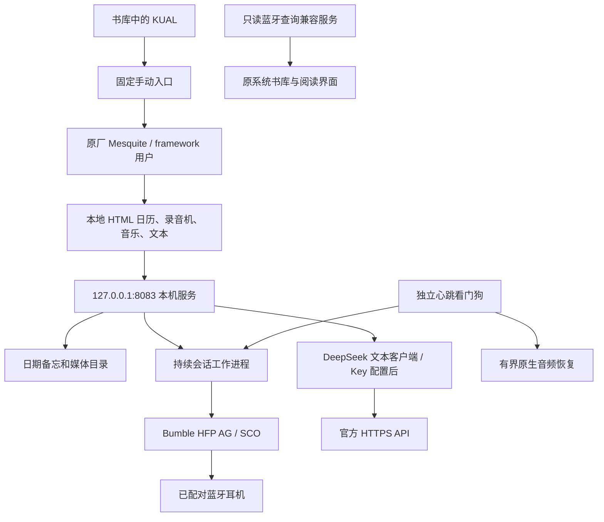

# 架构、代码与运行边界

## 目标设备

现场设备为 Kindle 8 / KT3（heisenberg），原固件 5.16.2.1.1，ARM Linux 3.10.53。显示屏继续由原主板驱动，未在这次交付中改接 S9 FPGA，也未把屏幕排线定义当作已完成的成果。

保留原书库、阅读器、触摸驱动和原厂页面引擎。新增服务不是 Android，也不能据此任意安装 Android APP。

## 调用链

## 文件分工

| 源码 | 职责 |
|---|---|
| `src/app/server.py` | 本机 HTTP API、音频任务与入口调度 |
| `src/app/persistent_link.py` | 缺席、连接、断线、重试和退出状态机 |
| `src/app/persistent_headset.py` | 单个控制器所有者、HFP AG、RFCOMM/SCO |
| `src/app/voice_session.py` | 录音、回放、断线保存和媒体流读取 |
| `src/app/audio_lifecycle.py` | 会话所有权、心跳、原生服务恢复 |
| `src/app/bt-query-service.lua` | 回答原系统只读蓝牙查询，避免同步阻塞 |
| `src/app/headset_profile.py` | 固定耳机的已验证 RFCOMM 通道缓存 |
| `src/app/home_store.py` | 日期备忘、媒体索引及路径约束 |
| `src/app/media_prepare.py` | WAV 转换、MP3 解码准备 |
| `src/app/text_chat.py` | 待配置的 DeepSeek 纯文本客户端 |
| `src/dashboard.html`、`src/dashboard.js` | 当前桌面布局和交互 |
| `src/build-dashboard.py` | 生成 HTTP 与本地 WAF 页面 |
| `src/manual-control.c` | 固定 start/stop/status 权限入口 |
| `src/PatchKualDirect.java` | 针对已核对 KUAL 工件的入口变换工具 |

`home-before-dashboard.html` 是本项目先前界面模板，用于复用已经验证的音频控制逻辑。它不是原厂浏览器 JS。`home_features.py` 中尚保留早期服务桥接代码，但当前主页不再提供 AI 语音入口，不部署原语音服务器。

## 权限和持久化

- 页面以 framework 用户运行，不给浏览器引擎 root 权限。
- `manual-control` 只允许 UID 0 或 9000，且仅接受一个固定动作；直接执行固定服务名，不允许任意 shell 命令。
- 代码和运行库位于 root 保护目录 `/opt/kt3-home`；普通数据位于 `/mnt/us/kt3-home`。
- 本机 API 绑定回环地址，检查 Host；修改请求还检查独立 token。token 由本机服务注入页面，不写日志。它不是远程多用户认证系统。
- API Key 另存 `/var/local/kt3-home/deepseek.json`，权限 600，目录 700；不放进浏览器 JS 或 USB 可见数据区。
- 正常运行时真实 `/dev/root` 为只读。`rootfs` 的伪挂载行显示 rw，不能单凭该行断言真实根分区可写。

## 依赖与复现范围

设备运行环境含 ARM 软浮点兼容的 Python 3.11、Bumble、cryptography、原机 LIPC/Lua 和本机音频实验桥接组件。第三方运行库须从上游获取并按其许可构建；原厂库须从自己合法持有的设备提取。本仓库不附这些二进制。

MP3 包装程序依赖 [minimp3](https://github.com/lieff/minimp3)；源码快照中的 `mp3decode.c` 不是独立完整解码器。KUAL 变换工具依赖 ASM 和匹配的 KUAL 工件；不能对任意版本直接套用。

公开版本用于审查设计、运行纯逻辑测试和研究移植。首次在全新设备从 stock 重建尚未作为一键流程验证，不提供“通刷”承诺。
