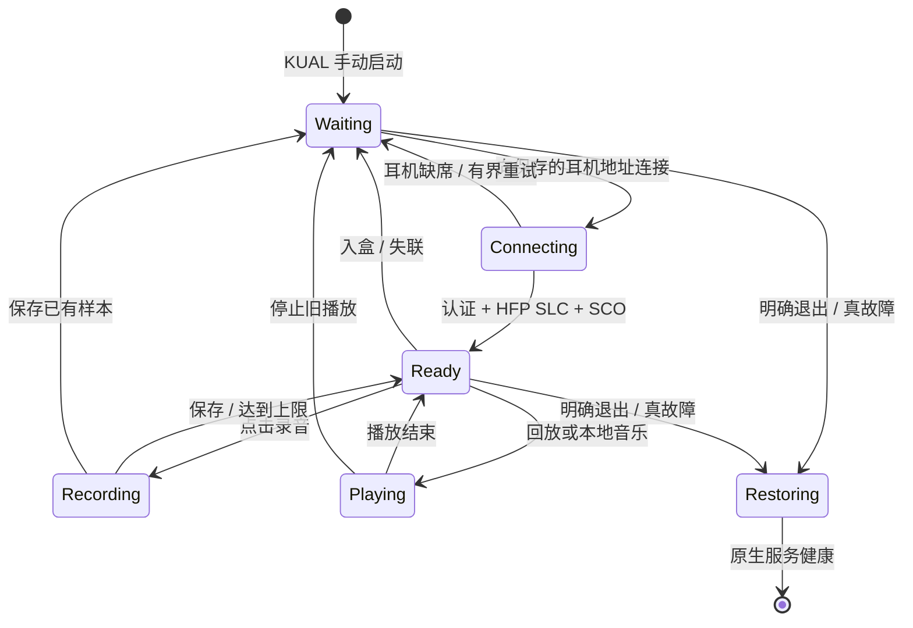

# 蓝牙双工、固定耳机自动连接与原生恢复

## 从只能播放到同时录放

原系统可经 VoiceView 向耳机播放，但 VoiceView 开启时限制浏览器使用；普通浏览器也没有可用的麦克风采集接口。初步关闭 VoiceView、保留音频播放后，网页和 AirPods 能同时使用。麦克风则需要另一条底层通路。

实现使用 Bumble 的 HFP Audio Gateway 与耳机建立 SLC，然后建立 SCO，采用 CVSD 对应的 8 kHz 单声道 PCM。录音与回放由设备端工作进程处理，网页仅发送控制请求。它不是网页 `getUserMedia`，也不是同时使用 A2DP 和耳麦输入。

第一版录音与播放分开交接控制器，用户每次操作都听到重连；改成一个持续语音会话后，录音、保存和回放只切换数据流，不反复交回原生播放。实际测试确认可以一边听上一段、一边录新内容。

## 持续会话与耳机入盒

入盒会切断物理无线链路；“保留双工”指保留同一个控制器所有者、桥接和工作进程，不是声称耳机关机后 SCO 仍在线。取出后仍须认证、加密、SLC 和 SCO 握手。

按保存的目标地址直连，使用已有配对密钥；成功 SLC 后缓存该耳机已验证的 RFCOMM 通道。没有每次扫描所有附近设备。缓存不是跳过握手，也不是把某个现场通道号硬编码给全部耳机。

重试间隔逐步增加，最高约 20 秒；正常缺席不触发反复原生恢复。断线后不自动重放旧命令、不自动开始录音。控制器或传输真正故障、明确暂停/退出时，才进入安全恢复路径。

## 最难的问题：持有控制器后书库阻塞

早期用 SIGSTOP 暂停整个原生 BTFD 避免控制器竞争，音频工作了，但书库同步查询 `com.lab126.btfd/isAudibleAvailable` 时每次等待约 10000 ms，导致明显卡顿和 Application Error。

最终以独立 Lua 服务回答必需的只读查询；它不扫描、不配对、不操作控制器，不伪造写操作成功。原生 A2DP 状态如实显示不可用，原书库得到及时返回。测试中双工期间查询约 28～34 ms，安全退出后原生查询约 30 ms。

Lua 绑定的异步观察器没有保持事件循环活跃；裸 `run_event_loop()` 曾立即退出。改成有时限事件循环的持续调用，才保持查询服务在线。

用户曾观察到“关闭弹窗后重启”；对应一次日志的内核 boot ID 未变，而 KPPMainApp 重启，因此该轮属于界面框架重启，不能记录成整机重启。

## 恢复和防卡死

- 会话状态包含 boot 身份、随机会话标识和 PID/starttime；避免旧看门狗误伤新进程。
- 独立心跳看门狗监测工作进程，退出有上限；恢复失败落保护标记，不无限重启蓝牙。
- 原生关闭是异步的：不能只看到一次 stop/waiting 就立即拉起。要求关闭状态连续稳定约两秒，在有界窗口内再恢复。
- 之前持续会话设置 `preventScreenSaver=1`，导致短按电源被忽略。现不再占用该全局标志；屏保/唤醒已由用户验证。
- 查询兼容、恢复服务与音频链路分别验证，不能用“听见声音”替代系统健康检查。

## 音质和验证范围

当前为通话级单声道，音乐会转换到相同采样格式；不提供高保真立体声承诺。当前单次录音上限 15 秒。一次性独立录音、持续会话、断线保存与用户听感均有验证，但长时间续航、所有蓝牙耳机兼容和内核深度挂起未完成。
